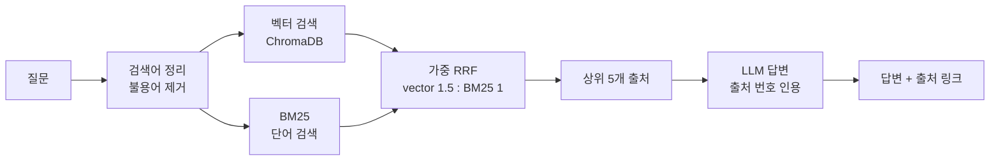

# Jarvis · 개인 세컨드 브레인 RAG

내가 저장해 둔 기록을 **물어보면 찾아서, 출처와 함께 답해 주는** 개인 AI 비서(RAG) 프로젝트입니다.
같은 구조를 두 가지 모드로 운영합니다.

| 모드 | 데이터 | 임베딩 / LLM | 실행 위치 |
|---|---|---|---|
| **Local** | 개인 데이터 (인스타그램 저장 게시물 등, 28,796건 / 36,767청크) | e5-small / Ollama (qwen2.5:3b) | 내 노트북 전용 (127.0.0.1) |
| **Cloud** | 공개 데이터 (arXiv 의료 AI 논문 제목·초록) | Gemini embedding / Gemini | Google Cloud Run (서울) |

**Live demo (Cloud 모드):** https://jarvis-rag-121185169470.asia-northeast3.run.app
> 첫 요청은 서버가 0대에서 켜지는 콜드 스타트 때문에 몇 초 걸릴 수 있습니다.

---

## 구조



- **하이브리드 검색:** 뜻으로 찾는 벡터 검색과 글자 일치로 찾는 BM25를 순위 기반(RRF)으로 합칩니다.
- **게시물 단위 중복 제거:** 같은 문서의 여러 조각이 결과를 차지하지 않게 합니다.
- **우아한 성능 저하:** Cloud 모드에서 임베딩 API가 실패하면 BM25만으로 계속 응답합니다.

---

## 검색 최적화 실험

저장 컬렉션 15개를 정답으로 삼아 Hit@10, Precision@10, Recall@10, MRR로 평가했습니다. 자세한 기록: [docs/experiments.md](docs/experiments.md)

| 실험 | 방법 | Hit@10 | MRR | 결론 |
|---|---|---|---|---|
| v0 | 벡터 (e5-small) | 0.733 | 0.340 | 기준선 |
| E1 | 벡터 (bge-m3, 약 5배 느림) | 0.733 | 0.344 | 효과 없음 → 채택 안 함 (전체 적용 시 약 13시간 추정 소요 회피) |
| E2 | 하이브리드 (RRF 1:1) | 0.667 | 0.492 | MRR 개선, 일부 정답 손실 |
| **E3** | **가중 하이브리드 (1.5 : 1)** | **0.733** | **0.497** | **채택. 손실 없이 MRR +46%** |
| E6 | E3 + 리랭커 | 0.800 | 0.476 | 질문당 약 55초(CPU) → 옵션으로만 |

추가로 실제 질문의 요청 말투("…알려줘", "저장한")가 검색을 흐리는 문제를 **불용어 제거**로 해결했습니다(E5).
같은 15개 질문으로 반복 조정한 만큼 과적합 위험이 있어, 자연어 평가 질문을 늘리는 것이 다음 과제입니다.

---

## 운영 · 보안 설계 (Cloud 모드)

- **개인 데이터 분리:** 클라우드 이미지는 허용 목록(allowlist) 방식으로 공개 데이터만 포함합니다.
- **비밀값 관리:** API 키는 Secret Manager에 두고, 그 값 하나만 읽을 수 있는 최소 권한 서비스 계정으로 실행합니다.
- **비용 보호:** 요청 횟수 제한, 입력 길이 제한, 최대 인스턴스 1개, 지출 상한(Spend cap)과 예산 알림을 적용했습니다.
- **로그:** 요청 기록을 구조화된 JSON 로그로 남겨 Cloud Logging에서 검색할 수 있습니다.
- **장애 기록:** 2026-10-17 배포 과정에서 발생한 장애와 해결 과정은 [docs/deploy.md](docs/deploy.md)의 *Incidents*에 정리했습니다.

---

## 실행 방법

### Local 모드 (개인 데이터, 노트북 전용)
```powershell
python -m venv .venv
.venv\Scripts\Activate.ps1
pip install -r requirements.txt
uvicorn app.main:app          # http://127.0.0.1:8000
```
- 개인 데이터와 인덱스 경로는 `JARVIS_DATA_DIR` 환경변수로 지정합니다. 데이터 자체는 저장소에 포함하지 않습니다.
- 답변 생성에는 로컬 Ollama(`qwen2.5:3b`)가 필요합니다.

### Cloud 모드 (공개 논문 + Gemini)
```powershell
# .env 에 GEMINI_API_KEY 설정 (저장소에 올리지 않음)
python scripts\fetch_arxiv.py --max 2000
python scripts\build_arxiv_index.py   # 무료 한도에 걸리면 다음 날 다시 실행하면 이어서 진행
$env:JARVIS_MODE="cloud"; uvicorn app.main:app
```

### Docker / 배포
```powershell
docker build -f Dockerfile.cloud -t jarvis-cloud:<ver> .
```
빌드, 업로드, Cloud Run 배포 명령은 [docs/deploy.md](docs/deploy.md)를 참고하세요.

---

## 폴더 구조

```
app/
  main.py           # FastAPI: /ask, /health, 요청 제한, 로그
  rag.py            # Local 엔진: e5 + ChromaDB + BM25 + Ollama
  rag_cloud.py      # Cloud 엔진: Gemini + ChromaDB + BM25 (BM25 fallback)
  static/index.html # 웹 채팅 화면 (출처 링크, XSS 방어)
scripts/            # 데이터 추출, 인덱스 생성, 평가(eval_*), 로그 통계
docs/               # 실험 기록, 배포·장애 기록
Dockerfile          # Local 이미지 (개인 데이터는 실행 시 마운트)
Dockerfile.cloud    # Cloud 이미지 (torch 없음, 공개 데이터만)
```

---

## 기술 스택

Python · FastAPI · ChromaDB · rank-bm25 · sentence-transformers (e5) · Ollama · Gemini API · Docker · Google Cloud Run · Artifact Registry · Secret Manager · Cloud Logging

## 다음 계획

- 평가 질문 50개 이상으로 확대해 재검증
- 답변 스트리밍(체감 속도 개선)
- 텔레그램 봇 연결, 새 논문 자동 수집 (개인 비서 "자비스"로 확장)
